# Teste Caixa Cinza em API de Autenticação com Supabase e Postman

**Aluno:** Vítor Silva de Aguiar
**RA:** 252264
**Curso:** Análise e Desenvolvimento de Sistemas, UniFacens
**Componente curricular:** UX/UI e Testes de Software

---

## Sumário

1. [Introdução](#introdução)
2. [Objetivo da Atividade](#objetivo-da-atividade)
3. [Configuração do Supabase](#configuração-do-supabase)
4. [Configuração do Postman](#configuração-do-postman)
5. [Configuração das Requisições](#configuração-das-requisições)
6. [Execução dos Testes](#execução-dos-testes)
7. [Registro dos Testes](#registro-dos-testes)
8. [Resultados Obtidos](#resultados-obtidos)
9. [Conclusão](#conclusão)

---

## Estrutura do Repositório

```
/README.md      -> documentação completa da atividade
/postman/       -> collection e environment exportados do Postman
/prints/        -> evidências reais produzidas durante a atividade
/planilha/      -> planilha de registro dos testes (registros.xlsx)
```

> Por segurança, os arquivos exportados do Postman estão com os valores das variáveis (`base_url`, `api_key`, `email` e `password`) em branco. Para reproduzir os testes, basta importar a collection e o environment e preencher as variáveis com as credenciais do seu próprio projeto Supabase.

---

## Introdução

Testes de caixa cinza combinam características dos testes de caixa branca e de caixa preta: o testador não tem acesso ao código-fonte completo, mas conhece parte da estrutura interna do sistema, como endpoints, formato das requisições, mecanismo de autenticação e estrutura das respostas.

Nesta atividade, o sistema sob teste é a **API de autenticação do Supabase**, uma plataforma de desenvolvimento baseada em PostgreSQL que oferece autenticação, banco de dados e APIs prontas. Como o conhecimento sobre a estrutura da API é parcial (endpoint, headers, corpo JSON e respostas HTTP), o cenário se encaixa na abordagem de caixa cinza.

As ferramentas utilizadas foram:

- **Supabase**: criação do ambiente de autenticação e do usuário de teste;
- **Postman Desktop**: criação, execução e automação dos testes de requisições HTTP;
- **GitHub**: versionamento e entrega da atividade.

Não foi desenvolvida interface gráfica, pois o foco é exclusivamente o teste da API.

---

## Objetivo da Atividade

Compreender e aplicar testes de caixa cinza em APIs de autenticação, utilizando ferramentas de mercado para configuração, execução e validação de testes funcionais. Durante a atividade foram realizados:

- configuração de um ambiente de autenticação com Supabase;
- criação de usuário para testes;
- estudo do funcionamento de requisições HTTP;
- execução de testes com o Postman;
- validação de respostas de autenticação (status HTTP, JSON e mensagens de erro);
- documentação técnica de todo o processo.

---

## Configuração do Supabase

### Como o projeto foi criado

1. Criei uma conta na plataforma Supabase (supabase.com).
2. Criei um novo projeto, informando nome, senha do banco de dados e a região **Americas**. As opções *Security Options* e *Advanced Configuration* foram mantidas no padrão.
3. Após a criação, o painel do projeto foi disponibilizado, com banco de dados PostgreSQL e API prontos para uso.

**Nome do projeto:** testes-autenticacao

### Tipo de autenticação utilizada

Foi utilizada a autenticação por **e-mail e senha**. No menu *Authentication > Sign In / Providers*, o provedor **Email** foi verificado e está com status **Enabled**.

A opção *Confirm email* ficou ligada. Quando ligada, o Supabase exige a confirmação do e-mail antes do primeiro login, e uma tentativa de login sem confirmação retorna o erro `email_not_confirmed`, mesmo com a senha correta.

### Como o usuário foi criado

Em *Authentication > Users*, utilizei o botão **Add user** para cadastrar manualmente um usuário válido de teste, com e-mail e senha definidos por mim. Também foi utilizada a função Auto Confirm User.

### Objetivo da configuração

Disponibilizar um serviço de autenticação real, com um usuário conhecido, para que os testes caixa cinza pudessem comparar o comportamento da API com credenciais válidas e inválidas.

### Credenciais obtidas

- **API URL (Project URL):** utilizada na variável `base_url` do Postman;
- **API Key (anon public):** utilizada na variável `api_key` e nos headers das requisições.

> Os valores completos não são publicados neste repositório. Nos prints, a chave aparece parcialmente tarjada.

### Evidências

**Projeto criado**

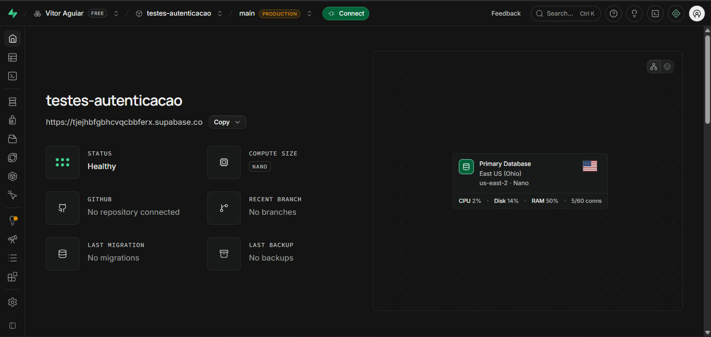

**Painel do Supabase**

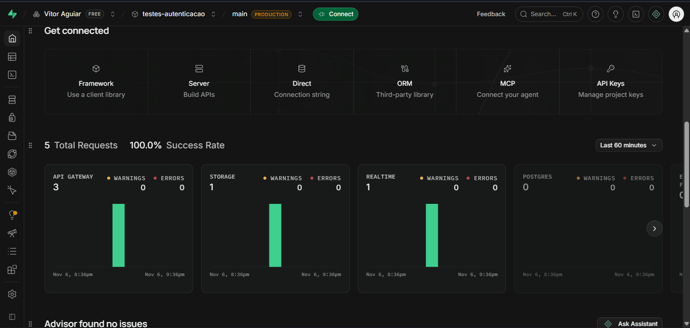

**Autenticação por e-mail habilitada**

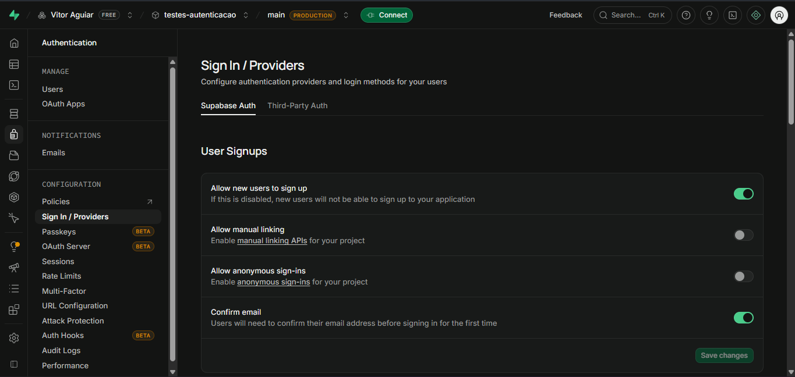

**Usuário criado**

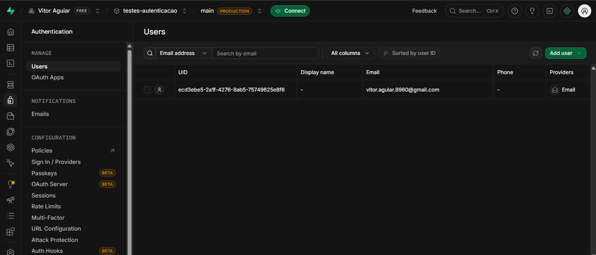

**Credenciais da API**

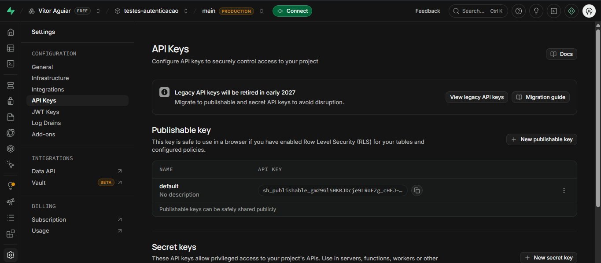

**Identificação do aluno no ambiente**

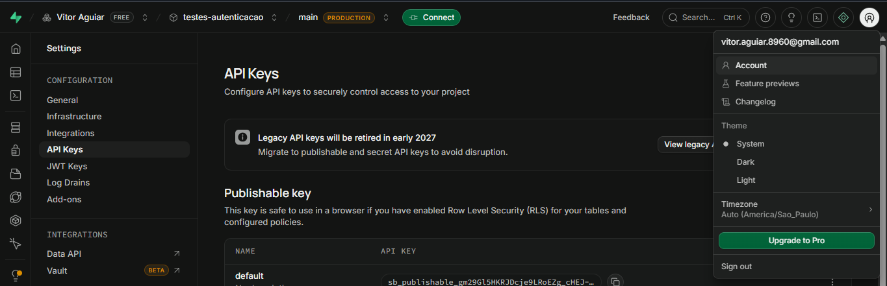

---

## Configuração do Postman

### Workspace

Instalei o Postman Desktop e criei um Workspace dedicado à atividade, para manter collection e environment organizados e separados de outros projetos.

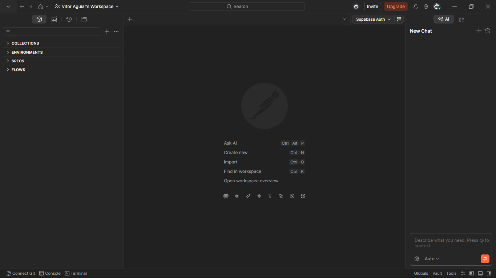

### Environment

Criei o Environment **Supabase Auth** e o selecionei como ambiente ativo, para que as variáveis `{{...}}` sejam resolvidas nas requisições.

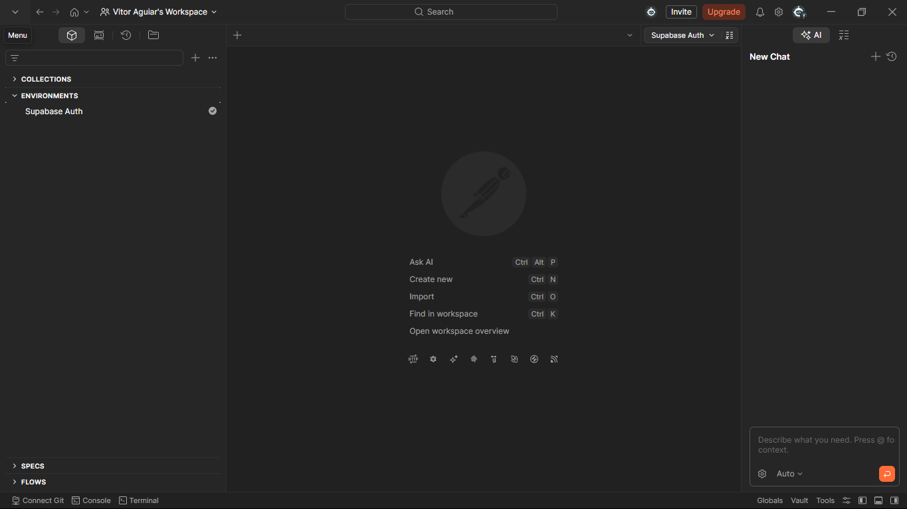

### Variáveis configuradas

| Variável | Descrição |
|---|---|
| `base_url` | URL da API do Supabase (Project URL) |
| `api_key` | API Key pública (anon) do projeto |
| `email` | E-mail do usuário válido criado no Supabase |
| `password` | Senha do usuário válido criado no Supabase |

**Finalidade das variáveis:** centralizar os dados de acesso em um único lugar. Assim, o endereço, a chave e as credenciais não precisam ser repetidos em cada requisição, a troca de projeto exige alterar apenas o environment, e os dados sensíveis ficam fora da collection exportada.

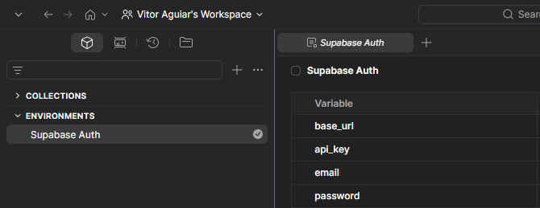

### Como o Postman foi utilizado nos testes

O Postman foi usado para: (1) montar as requisições HTTP contra a API de autenticação; (2) enviar cada cenário de teste; (3) inspecionar status e corpo das respostas; e (4) automatizar as validações com scripts (*Post-response*), executados em conjunto pelo **Collection Runner**.

### Organização do Postman

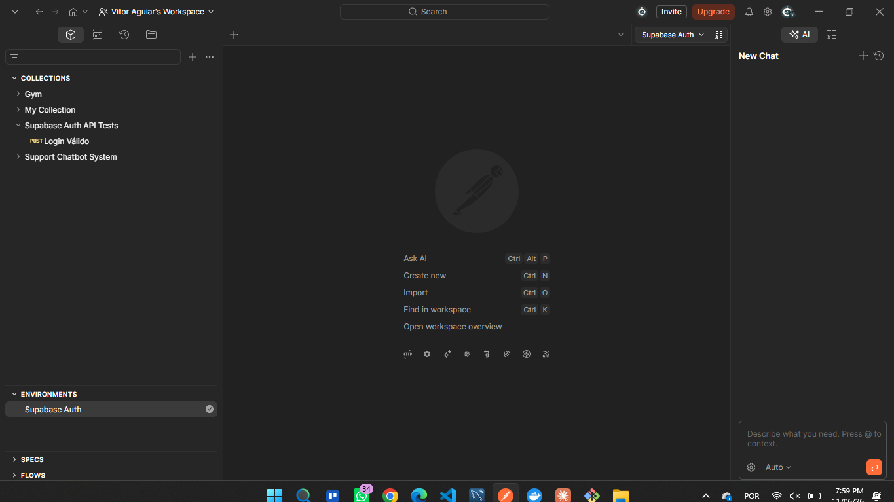

---

## Configuração das Requisições

### Endpoint

```
POST {{base_url}}/auth/v1/token?grant_type=password
```

### Método HTTP

`POST`

### Headers utilizados

| Header | Valor |
|---|---|
| `apikey` | `{{api_key}}` (exemplo: `eyJhbGciOi...XXXXX`) |
| `Authorization` | `Bearer {{api_key}}` |
| `Content-Type` | `application/json` |

### Body JSON utilizado (cenário de login válido)

Formato: `raw` / `JSON`.

```json
{
  "email": "{{email}}",
  "password": "{{password}}"
}
```

Exemplo ilustrativo com valores literais, como usado nos cenários inválidos:

```json
{
  "email": "usuario@email.com",
  "password": "123456"
}
```

### Finalidade da requisição

Realizar o login de um usuário no Supabase pelo fluxo de senha (`grant_type=password`). Se as credenciais estiverem corretas, a API responde com status `200` e um JSON contendo o `access_token`. Se estiverem incorretas, responde com erro `4xx` e uma mensagem descritiva.

### Evidências

**Endpoint configurado**


**Headers**

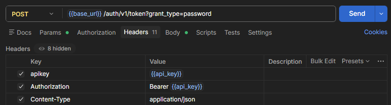

**Body JSON**

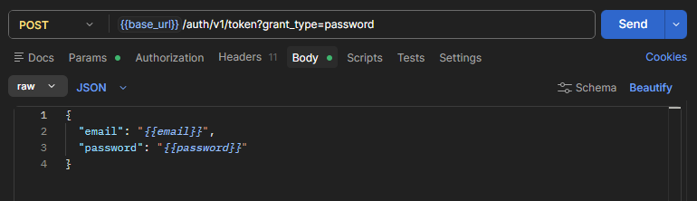

**Requisição criada no Postman**

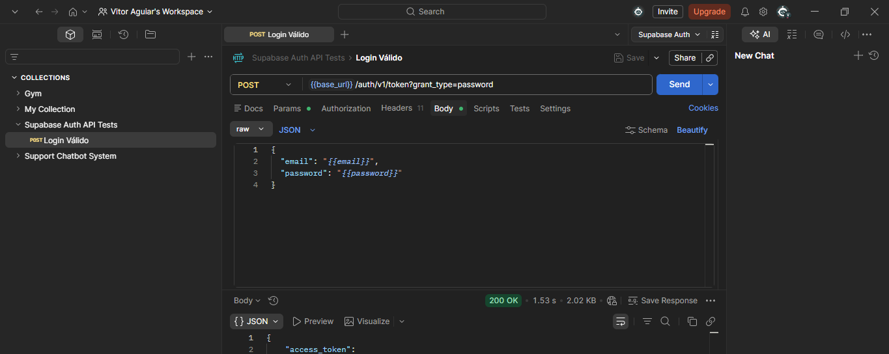

---

## Execução dos Testes

Foram executados os cinco cenários obrigatórios. Cada cenário foi enviado individualmente e depois todos foram executados em conjunto pelo Collection Runner.

### Scripts de validação

Foram adicionados scripts na aba *Scripts > Post-response* para validar automaticamente status e corpo da resposta.

**Script do cenário válido**

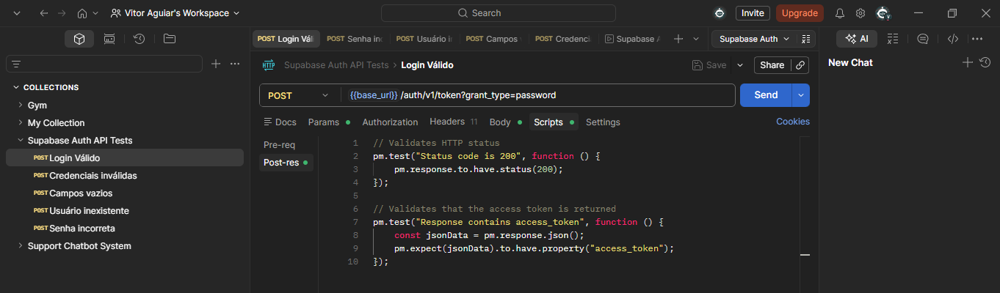

**Script dos cenários inválidos**

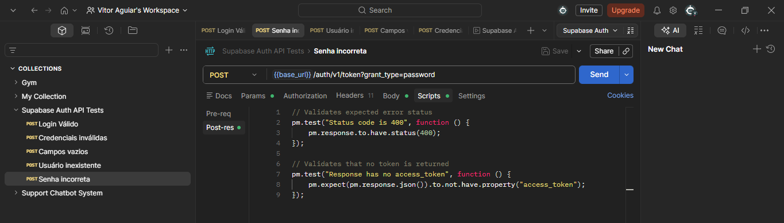

### Tabela de cenários

| Cenário | Entrada Utilizada | Resultado Esperado | Resultado Obtido | Status |
|---|---|---|---|---|
| Login válido | E-mail e senha do usuário criado no Supabase | Status 200 + access token | 200 e access token | Sucesso |
| Senha incorreta | E-mail válido + senha errada | Erro de autenticação | 400 Bad Request | Sucesso |
| Usuário inexistente | E-mail não cadastrado + qualquer senha | Acesso negado | 400 Bad Request | Sucesso |
| Campos vazios | email: "" e password: "" | Erro de validação | 400 Bad Request | Sucesso |
| Credenciais inválidas | E-mail e senha inexistentes/inválidos | Mensagem de erro | 400 Bad Request | Sucesso |

### Cenário 1: Login válido

- **Entrada:** variáveis `{{email}}` e `{{password}}` do usuário criado.
- **Validações:** status HTTP, presença de `access_token` no JSON.
- **Resultado obtido:** status `200 OK`, com JSON contendo o `access_token`. O login foi concedido e o fluxo de autenticação funcionou.


### Cenário 2: Senha incorreta

- **Entrada:** e-mail correto e senha incorreta.
- **Validações:** status HTTP de erro e ausência de `access_token`.
- **Resultado obtido:** status `200 OK`, com JSON contendo o `access_token`. O login foi concedido e o fluxo de autenticação funcionou.

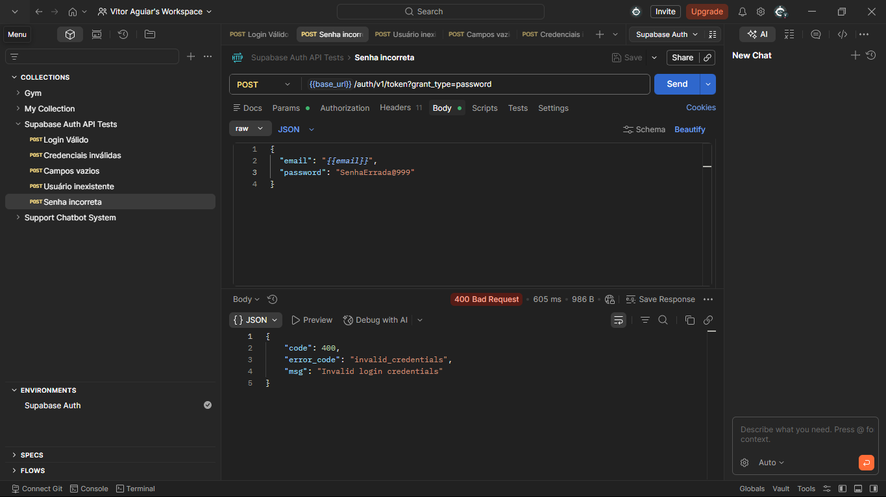

### Cenário 3: Usuário inexistente

- **Entrada:** e-mail que não existe na base.
- **Validações:** acesso negado e ausência de `access_token`.
- **Resultado obtido:** status `400 Bad Request` com mensagem de erro no JSON. O acesso foi negado e nenhum `access_token` foi retornado.

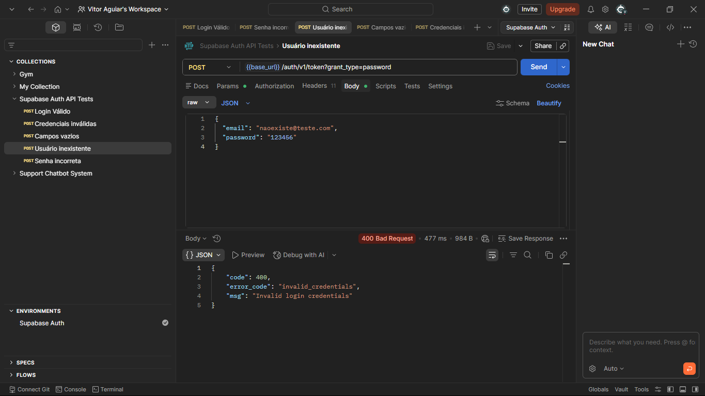

### Cenário 4: Campos vazios

- **Entrada:** `email` e `password` como strings vazias.
- **Validações:** erro de validação retornado pela API.
- **Resultado obtido:** status `400 Bad Request`. A API rejeitou a requisição sem processar o login, retornando erro no JSON.

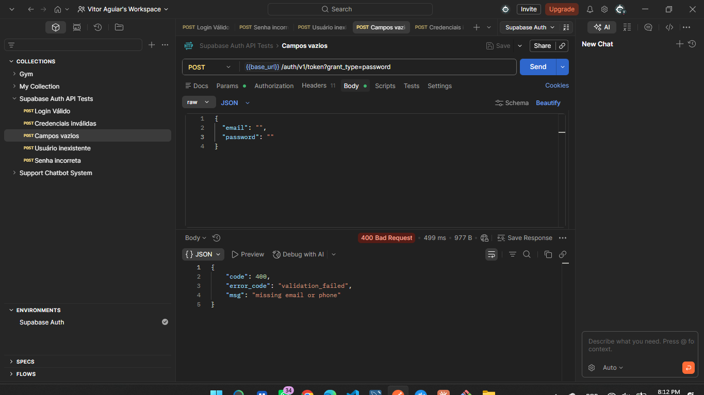

### Cenário 5: Credenciais inválidas

- **Entrada:** e-mail e senha incorretos.
- **Validações:** mensagem de erro e ausência de `access_token`.
- **Resultado obtido:** status `400 Bad Request`. A API rejeitou a requisição sem processar o login, retornando erro no JSON.

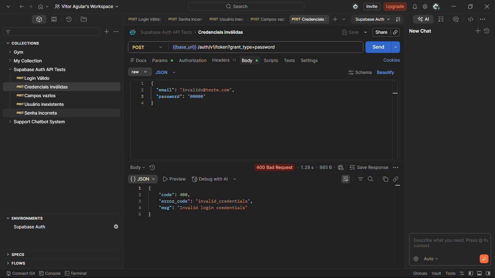

### Erros encontrados durante a execução

Não foram encontradas falhas no comportamento da API: todos os cenários responderam conforme o esperado. A única dificuldade foi de configuração: como a opção *Confirm email* ficou ligada, um usuário sem e-mail confirmado seria barrado no login mesmo com a senha correta (erro `email_not_confirmed`). Por isso o usuário de teste foi criado com a opção *Auto Confirm User*, o que permitiu o login válido retornar `200`.

---

## Registro dos Testes

### Como os testes foram registrados

Os testes foram registrados na planilha [`planilha/registros.xlsx`](planilha/registros.xlsx), preenchida somente após a execução de cada cenário, com os resultados reais. Os campos registrados foram:

| Campo | Descrição |
|---|---|
| ID do teste | Identificação do caso de teste |
| Cenário | Descrição do cenário |
| Entrada | Dados utilizados |
| Resultado esperado | Resultado correto segundo a especificação |
| Resultado obtido | Resultado real observado |
| Status | Sucesso ou Falha |
| Observações | Comentários |

### Importância da documentação dos testes

Documentar os testes garante rastreabilidade (é possível saber o que foi testado, com quais dados e com qual resultado), permite repetir os testes de forma idêntica após mudanças no sistema (regressão), facilita a comunicação entre testadores e desenvolvedores e serve como evidência de qualidade.

### Falhas identificadas

Nenhuma falha foi identificada. Os cinco cenários tiveram o resultado obtido compatível com o esperado: o login válido retornou `200` com token, e os quatro cenários inválidos foram rejeitados com `400 Bad Request` e sem retorno de token.

### Evidências

**Planilha preenchida**

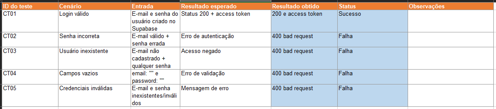

**Exemplos de registros realizados**

| ID | Cenário | Entrada | Resultado esperado | Resultado obtido | Status |
|---|---|---|---|---|---|
| CT01 | Login válido | E-mail e senha corretos | 200 + `access_token` | 200 e access token | Sucesso |
| CT02 | Senha incorreta | E-mail correto, senha errada | Erro de autenticação | 400 Bad Request | Sucesso |

---

## Resultados Obtidos

### Execução conjunta (Collection Runner)

Após validar cada requisição individualmente, executei a collection completa pelo Collection Runner. O resultado consolidado mostra o status de cada requisição e de cada asserção dos scripts.

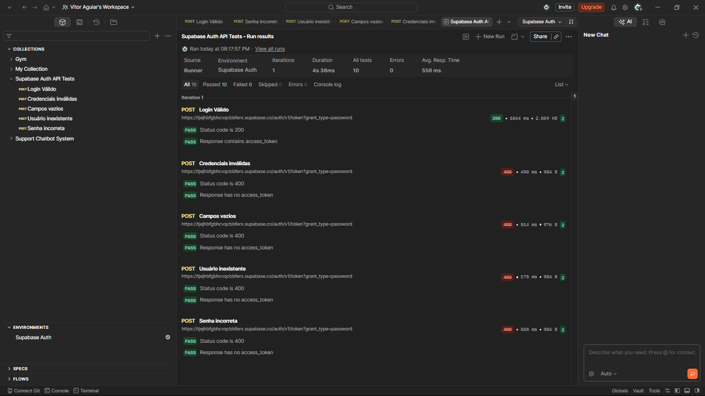

### Resumo

| Item | Resultado |
|---|---|
| Total de cenários executados | 5 |
| Cenários com sucesso | 5 |
| Cenários com falha | 0 |
| Access token retornado no login válido | Sim |
| Mensagens de erro retornadas nos cenários inválidos | Sim, em todos os 4 cenários (status 400 com erro no JSON) |

### Observações sobre o comportamento da API

- Todos os cenários inválidos retornaram o mesmo status (`400 Bad Request`), inclusive senha incorreta e usuário inexistente. Em APIs de autenticação isso é uma boa prática de segurança, pois evita que um atacante descubra quais e-mails estão cadastrados (enumeração de usuários).
- Em nenhum cenário inválido a API devolveu `access_token`, o que confirma que o acesso foi corretamente bloqueado.
- A API validou os campos vazios antes de tentar autenticar, retornando erro imediato.
- A opção *Confirm email* do Supabase influencia diretamente o resultado do login: com ela ligada, só usuários confirmados conseguem autenticar.

---

## Conclusão

**Os testes foram executados corretamente?** Sim. Os cinco cenários obrigatórios foram executados primeiro de forma individual e depois em conjunto pelo Collection Runner, com scripts de validação para status HTTP e presença do `access_token`. Todas as evidências foram produzidas por mim durante a atividade.

**A autenticação funcionou?** Sim. O usuário válido recebeu status `200` e um `access_token`, e todas as tentativas com dados incorretos, inexistentes ou vazios foram rejeitadas com `400 Bad Request`, sem retorno de token. Isso mostra que a API concede acesso apenas a quem informa credenciais corretas.

**Dificuldades encontradas:** a principal foi entender o efeito da opção *Confirm email* do Supabase, que bloqueia o login de usuários não confirmados mesmo com senha correta; foi resolvida criando o usuário com *Auto Confirm User*. Também exigiu atenção configurar o environment do Postman e garantir que ele estivesse selecionado, para que as variáveis `{{base_url}}` e `{{api_key}}` fossem resolvidas, além de escrever scripts de validação separados para cenários válidos e inválidos.

**Falhas identificadas:** nenhuma falha na API. O comportamento de todos os cenários foi o esperado.

**Melhorias que poderiam ser implementadas:**

- automatizar a execução da collection em pipeline (Postman CLI / Newman);
- ampliar a cobertura com cenários de valores-limite (e-mail com formato inválido, senhas muito longas ou muito curtas, caracteres especiais);
- testar o comportamento de bloqueio por excesso de tentativas (*rate limit*);
- validar a expiração e a renovação do token (`refresh_token`);
- incluir testes do fluxo de cadastro (*sign up*).

**Importância dos testes caixa cinza em APIs:** como o testador conhece endpoints, headers e formato das respostas, ele consegue montar cenários mais precisos do que em um teste puramente de caixa preta, sem depender do código-fonte, como na caixa branca. Em APIs de autenticação, isso permite verificar com rapidez e baixo custo se o sistema concede acesso a quem deve e bloqueia quem não deve, além de validar status HTTP e mensagens de erro antes mesmo de existir uma interface gráfica.

---

## Referências

- Documentação do Supabase Auth: https://supabase.com/docs/guides/auth
- Documentação do Postman: https://learning.postman.com
- Material da aula: *UX/UI e Testes de Software, Testes Funcionais (Caixa Cinza)*, UniFacens.